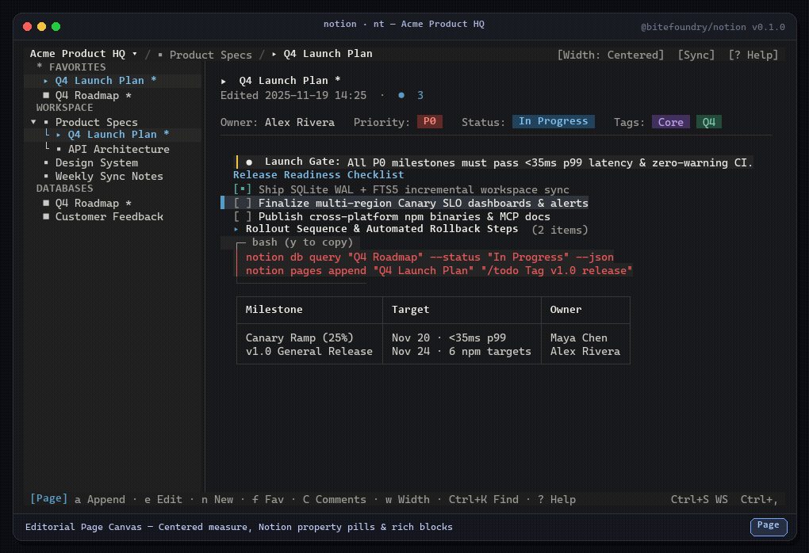

<div align="center">

# `@bitefoundry/notion`

**Read and edit Notion pages, work with database records, and search a synced workspace from the terminal.**

[](https://www.npmjs.com/package/@bitefoundry/notion)
[](docs/NPM.md)
[](https://github.com/BiteFoundry/notion/blob/master/Cargo.toml)
[](LICENSE)

[BiteFoundry](https://bitefoundry.dev/#app-notion) · [Latest release notes](https://github.com/BiteFoundry/notion/releases/latest)

<br />



</div>

---

## Highlights

| Pillar | Capabilities |
| :--- | :--- |
| **Minimal-Chrome TUI** | Authentic Notion editorial aesthetic (`notion`): 1-line **Breadcrumb Bar**, collapsible **Workspace Sidebar (`[`)** with Favorites & nested tree, **Centered (~88 col) / Full Width (`w`) Page Canvas**, 10 canonical Notion pill colors, live interactive **`to_do` checkboxes (`Space`/`x`)** & **`toggle` blocks**, **Database Table (`1`) / Board Kanban (`2`) / List (`3`) views**, **Comments Peek Drawer (`C`)**, **Quick Find (`Ctrl+K`)**, **Multi-Workspace Switcher (`Ctrl+S`)**, and **5 curated palettes** (`Clean Dark`, `Warm Paper`, `Tokyo Night`, `Catppuccin`, `Nord`). |
| **High-Res Terminal Images** | Native inline image previews for Notion-hosted & external media via **Kitty Graphics**, **iTerm2**, **Sixel**, and **24-bit Truecolor Half-Block (`▀`)** fallback (`v` HD modal & `notion download`). |
| **Local SQLite FTS5 + IPC Daemon** | Workspace-scoped SQLite WAL + FTS5 cache (`pages`, `databases`, `blocks`, `comments`, `pages_fts`) with automatic `<3`-char Korean/CJK `LIKE` fallback, plus single-instance background sync IPC daemon (`notion daemon start`). |
| **4-in-1 Agent Interface** | Same binary powers the **Interactive TUI**, scriptable **`--json` CLI**, local **HTTP JSON API** (`notion serve`, `:8791`), and **stdio MCP server** (`notion mcp`, **20 typed tools** with `confirm: true` archive guard). |

---

## Quick Start

Upgrading from 0.1.x? Change `nt` to `notion` in shell scripts and set the MCP server’s `command` to `notion`.

```bash
# 1. Install globally (installs the native `notion` command)
npm i -g @bitefoundry/notion

# 2. Authenticate — Internal Integration Token (30-second setup) or Public OAuth 2.0
notion login --token ntn_...
# Or Public OAuth 2.0 loopback:
notion login --oauth --client-id "$NOTION_CLIENT_ID" --client-secret "$NOTION_CLIENT_SECRET"

# 3. Sync your workspace & launch the Notion-native TUI
notion sync
notion
```

```sh
notion pages get PAGE_ID --json
```

Read page Markdown and see which blocks or comments were loaded. A compact read skips the comments request. Use `notion comments list PAGE_ID --json` to fetch comments separately. For full detail, add `--full` in the CLI or pass `compact: false` to `get_page` in MCP.

---

## Keybindings Cheat Sheet

| Key | Action | Context |
| :--- | :--- | :--- |
| `[` / `Ctrl+B` | Toggle collapsible Workspace Sidebar | Global |
| `Tab` / `Shift+Tab` | Cycle focus across Sidebar, Canvas, and Comments Drawer | Global |
| `j` `k` / `↑` `↓` | Move across sidebar tree, page blocks, or database rows | Global |
| `Space` / `x` | Check/uncheck live `to_do` block or expand/collapse `toggle` block | Page Canvas |
| `w` / `f` / `y` | Toggle Centered vs Full Width / Favorite star / Copy code block | Page Canvas |
| `a` / `n` / `e` | Slash Quick Append (`/h1`, `/todo`, `/callout`) / New Page / `$EDITOR` | Page / Database |
| `C` | Toggle right-split Comments Peek Drawer & reply inline | Page Canvas |
| `1` / `2` / `3` | Switch Database views: **Table** / **Board (Kanban)** / **List** | Database |
| `f` / `s` / `m` | Filter rows / Cycle sort / Move Kanban card to another Status column | Database |
| `Ctrl+K` / `Ctrl+P` | Quick Find & Command Palette (FTS5 search + workspace commands) | Global |
| `u` / `Ctrl+F` / `v` | Link Extractor / File Picker (`z` zoxide) / HD Image Preview | Global |
| `Ctrl+S` / `Ctrl+,` / `?` | Switch Workspace / Settings & Palettes / Keyboard Shortcuts Help | Global |

---

## CLI, HTTP API & MCP

### CLI (`--json` ready)

```bash
# Search, read, append & export Notion pages
notion search "Q4 Roadmap" --json
notion pages list --json
notion pages get "Q4 Launch Plan"
notion pages get "Q4 Launch Plan" --json
notion pages get "Q4 Launch Plan" --json --full
notion pages edit "Q4 Launch Plan" --editor
notion pages append "Q4 Launch Plan" "/todo Tag v1.0 release"
notion pages export "Q4 Launch Plan" --out launch-plan.md
notion blocks edit <block-id> --text "Release **verified**" --json
notion blocks toggle <block-id>

# Query & create Notion database items, list workspace users
notion db list --json
notion db query "Q4 Roadmap" --json
notion db create-item "Q4 Roadmap" --title "Ship v1.0" --status "In Progress"
notion users list --json
notion comments list "Q4 Launch Plan" --json --limit 50 --cursor <next_cursor>
notion comments add "Q4 Launch Plan" "Green light for launch!"
notion download <url-or-block-id> --json

# Multi-workspace profiles & background sync daemon
notion workspaces list
notion workspaces add work --token ntn_...
notion workspaces use work
notion daemon start
```

**Identifier resolution & `--json` exit contract:** UUIDs and Notion URLs pass through directly with zero extra lookups. Read commands accept exact or partial titles (preferring active pages), while write commands require a single exact title match among active pages (use `--unarchive` with a page ID or URL if an archived page is not in the local cache; pass a page ID or URL whenever duplicate or newly-created external titles may exist). Runtime failures under `--json` exit `1` and print `{"ok":false,"error":{"code":"...","message":"..."}}` to stdout (with `details.candidates` for ambiguous/missing titles); argument usage errors exit `2` with stderr usage text and empty stdout. On `--json`, treat exit `0` (and not `ok: false`) as success—some commands omit a top-level `ok` field, and `doctor --online --json` reports probe failures inside `online_probe.ok`.

### Local HTTP JSON API (`notion serve`)

```bash
notion serve --host 127.0.0.1 --port 8791 --api-key "$API_TOKEN"
curl -H "Authorization: Bearer $API_TOKEN" "http://127.0.0.1:8791/api/v1/search?q=Roadmap"
```

`/api/v1/*` always needs a key: pass `--api-key` or set `NOTION_SERVE_API_KEY`, otherwise a random key is generated for the run and printed once to stderr (`--allow-keyless` turns it off on loopback binds). Browsers are locked out by default: there are no CORS headers unless you pass `--cors-origin <origin>`, and requests with a foreign `Host` header are rejected (`--allowed-host <name>` adds one).

Full endpoint catalog and OpenAPI schema: **[docs/API.md](docs/API.md)** · **[docs/openapi.yaml](docs/openapi.yaml)**.

### MCP Server (`notion mcp` — 20 Tools)

```json
{
  "mcpServers": {
    "notion": {
      "command": "notion",
      "args": ["mcp"]
    }
  }
}
```

Full tool catalog and argument schemas: **[docs/MCP.md](docs/MCP.md)** · npm packaging details: **[docs/NPM.md](docs/NPM.md)**.

---

## `@bitefoundry` Enterprise Terminal Suite

| Package | Commands | Workspace | Interfaces |
| :--- | :--- | :--- | :--- |
| [`@bitefoundry/teams`](https://www.npmjs.com/package/@bitefoundry/teams) | `teams` | Microsoft Teams (Chats, Channels, Meetings & Threads) | TUI · CLI · HTTP · MCP |
| [`@bitefoundry/outlook`](https://www.npmjs.com/package/@bitefoundry/outlook) | `outlook` | Microsoft Outlook (Mail, Calendar & Contacts) | TUI · CLI · HTTP · MCP |
| [`@bitefoundry/onenote`](https://www.npmjs.com/package/@bitefoundry/onenote) | `onenote` | Microsoft OneNote (Notebooks, Sections & Pages) | TUI · CLI · HTTP · MCP |
| [`@bitefoundry/sharepoint`](https://www.npmjs.com/package/@bitefoundry/sharepoint) | `sharepoint`, `bitefoundry-onedrive` | Microsoft SharePoint & OneDrive (Sites, Libraries & Lists) | TUI · CLI · HTTP · MCP |
| [`@bitefoundry/atlassian`](https://www.npmjs.com/package/@bitefoundry/atlassian) | `atlassian`, `confluence`, `conf` | Atlassian Jira (Kanban, Sprints, JQL) & Confluence Wiki | TUI · CLI · HTTP · MCP |
| **`@bitefoundry/notion`** | `notion` | Notion (Editorial Pages, Interactive Blocks & Databases) | TUI · CLI · HTTP · MCP |

---

> **Disclaimer:** Unofficial terminal client for Notion. Not affiliated with, endorsed by, or sponsored by Notion Labs, Inc.
